# Obsidian Mermaid Diagram Collection

---

# 1. Complex Game Architecture

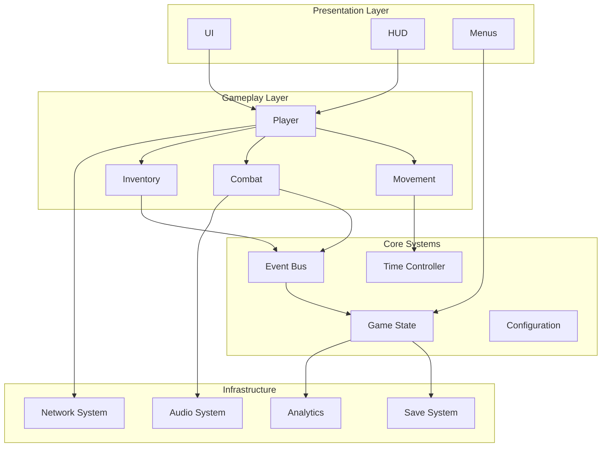

---

# 2. Layered Architecture

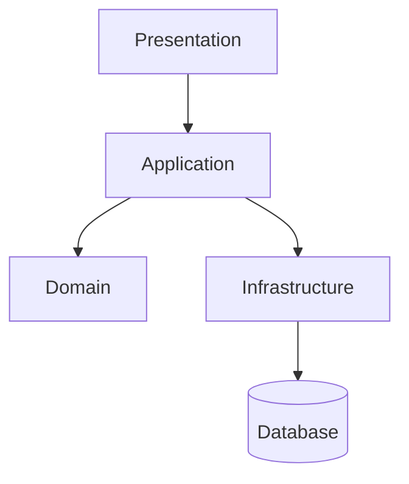

---

# 3. Dependency Graph

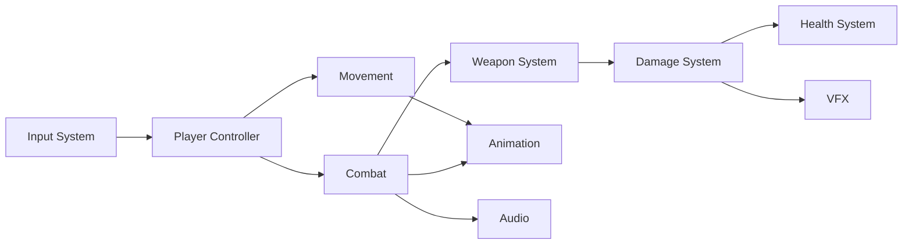

---

# 4. Complex State Machine

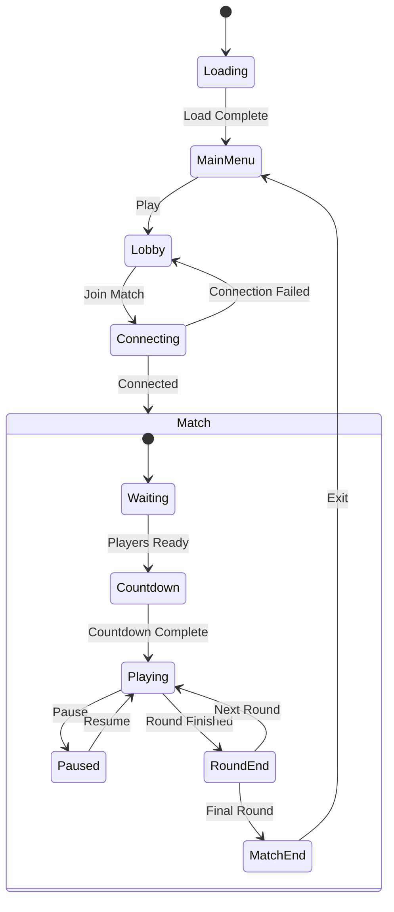

---

# 5. Player State Machine

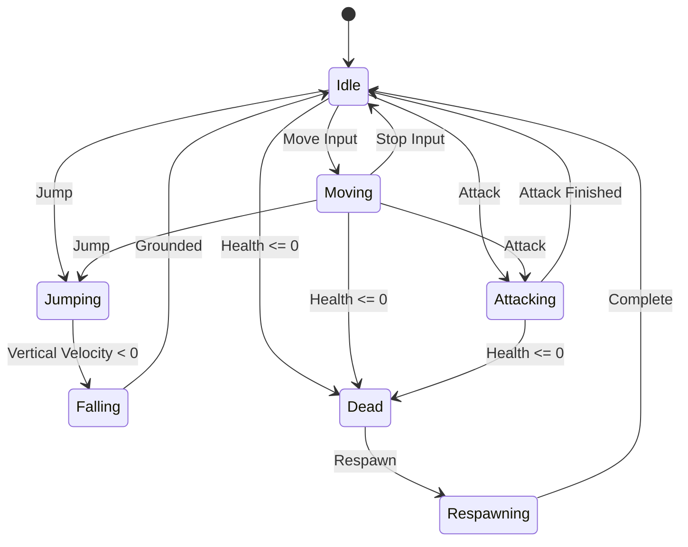

---

# 6. Complex Sequence Diagram

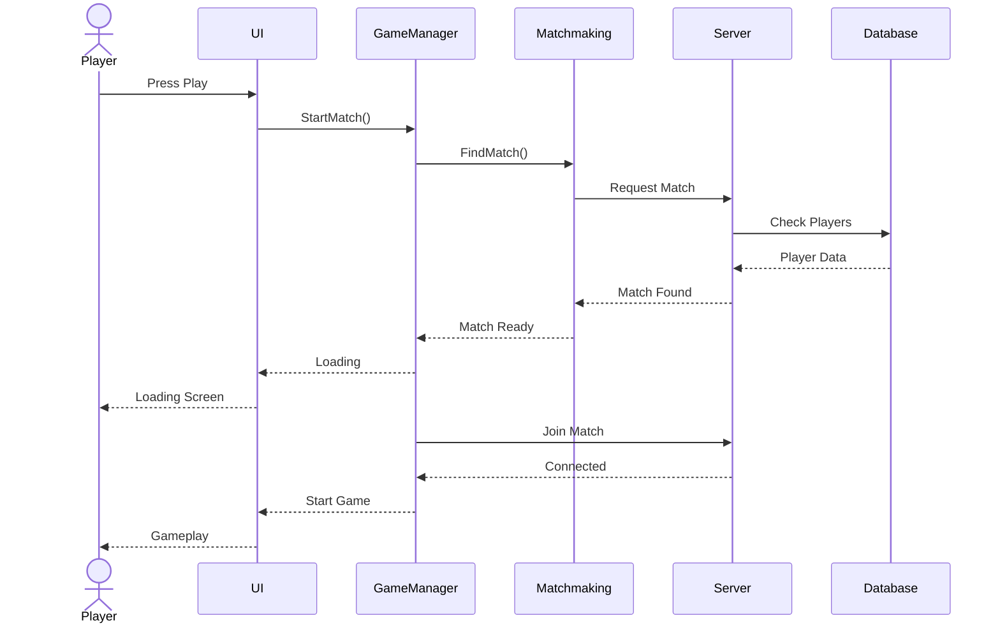

---

# 7. Multiplayer Sequence

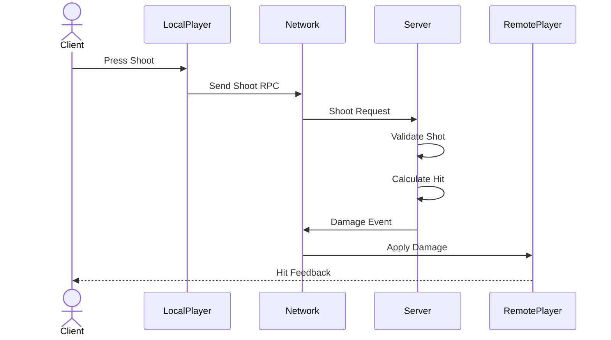

---

# 8. Class Diagram

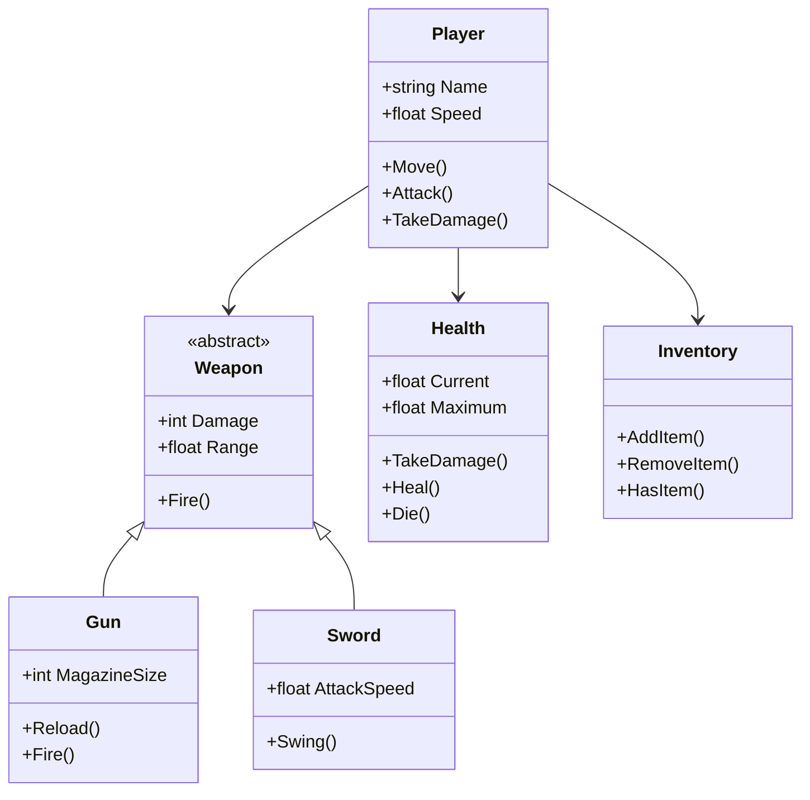

---

# 9. Larger Class Architecture

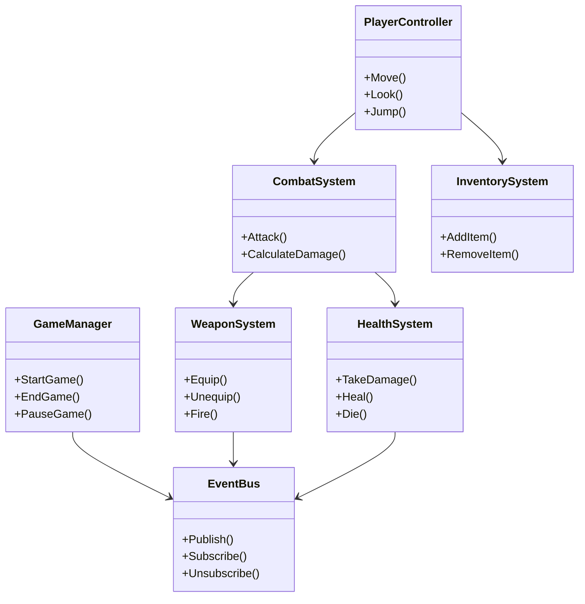

---

# 10. Entity Relationship Diagram

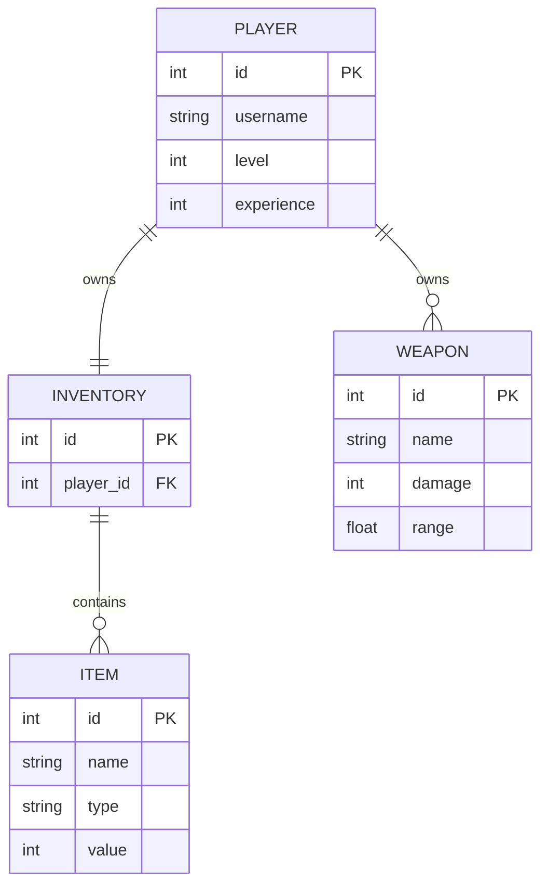

---

# 11. Database Architecture

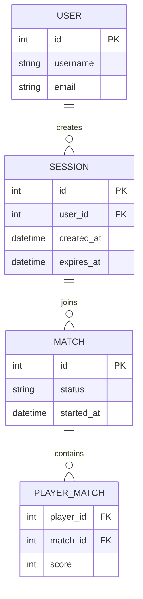

---

# 12. Decision Tree

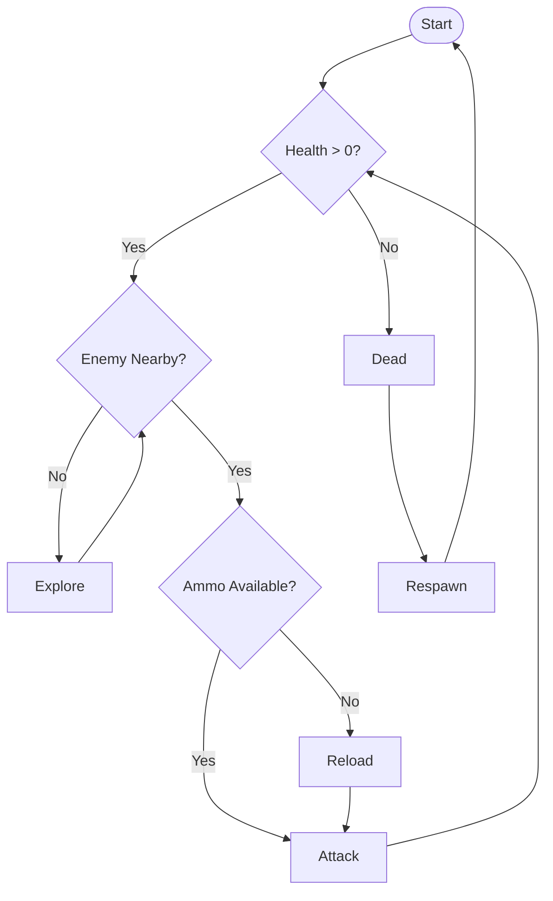

---

# 13. Complex Game Loop

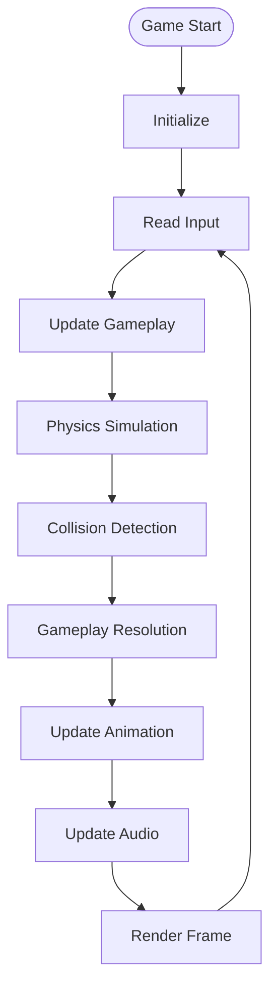

---

# 14. Data Flow Diagram

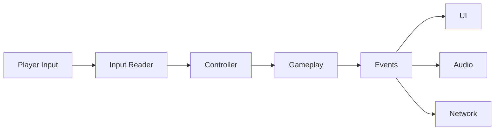

---

# 15. Event-Driven Architecture

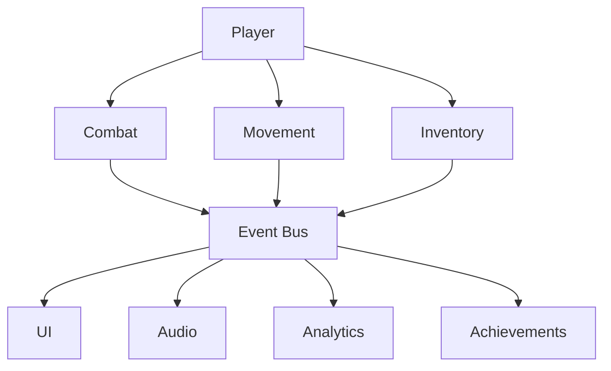

---

# 16. Microservice Architecture

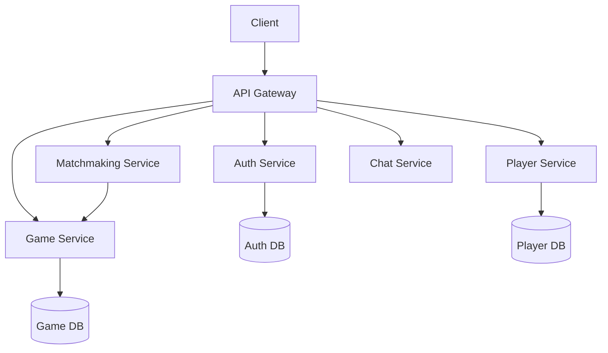

---

# 17. System Initialization

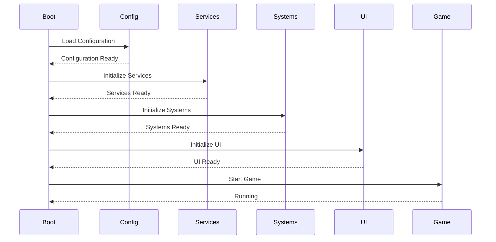

---

# 18. Object Lifecycle

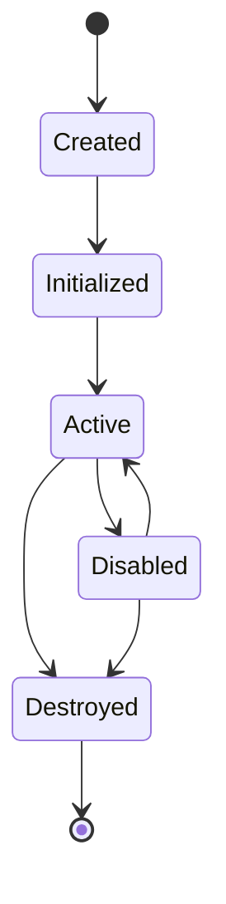

---

# 19. CI/CD Pipeline

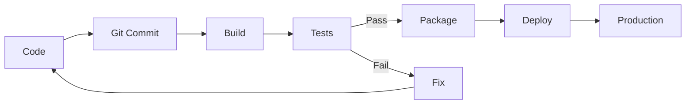

---

# 20. Git Workflow

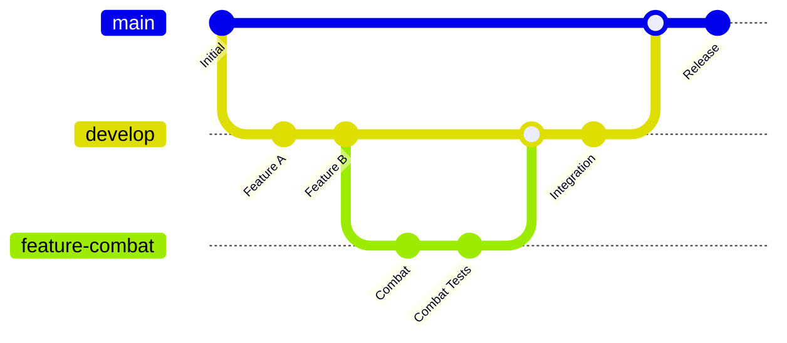

---

# 21. Project Timeline

```mermaid
timeline

    title Game Development Timeline

    2026 : Prototype
         : Core Systems
         : First Playable

    2027 : Vertical Slice
         : Multiplayer
         : Content Production

    2028 : Alpha
         : Testing
         : Optimization

    2029 : Beta
         : Polish
         : Marketing

    2030 : Release
```

---

# 22. Gantt Chart

```mermaid
gantt

    title Game Development

    dateFormat YYYY-MM-DD

    section Design

    Game Design :design, 2026-10-01, 20d

    section Programming

    Core Systems :core, 2026-10-10, 30d

    Gameplay :gameplay, after core, 40d

    Multiplayer :network, after gameplay, 30d

    section Art

    Environment :environment, 2026-10-20, 40d

    Characters :characters, 2026-11-01, 30d

    section Testing

    QA :qa, after network, 20d
```

---

# 23. Mind Map

```mermaid
mindmap

    root((Game))

        Gameplay
            Movement
            Combat
            Inventory
            AI

        Systems
            Input
            Audio
            Save
            Networking

        UI
            HUD
            Menus
            Settings
            Inventory

        Content
            Levels
            Characters
            Weapons
            Enemies
```

---

# 24. Large Mind Map

```mermaid
mindmap

    root((Software Engineering))

        Architecture
            Layers
            Modules
            Dependencies
            Interfaces

        Programming
            Algorithms
            Data Structures
            OOP
            Functional

        Infrastructure
            Networking
            Databases
            Cloud
            CI/CD

        Testing
            Unit
            Integration
            System
            Performance

        Operations
            Logging
            Monitoring
            Deployment
            Backups
```

---

# 25. Quadrant Chart

```mermaid
quadrantChart

    title Technology Priority

    x-axis Low Complexity --> High Complexity

    y-axis Low Value --> High Value

    quadrant-1 Strategic
    quadrant-2 Quick Wins
    quadrant-3 Low Priority
    quadrant-4 Avoid

    AI Tools: [0.8, 0.9]
    Automation: [0.7, 0.8]
    Documentation: [0.2, 0.6]
    Refactoring: [0.5, 0.7]
    Manual Tasks: [0.3, 0.2]
```

---

# 26. XY Chart

```mermaid
xychart-beta

    title "Performance"

    x-axis ["Jan", "Feb", "Mar", "Apr", "May"]

    y-axis "FPS" 0 --> 120

    line [60, 65, 72, 90, 110]

    bar [55, 70, 68, 85, 105]
```

---

# 27. Pie Chart

```mermaid
pie title Development Time

    "Programming" : 40
    "Design" : 20
    "Art" : 20
    "Testing" : 15
    "Documentation" : 5
```

---

# 28. Block Diagram

```mermaid
block-beta

    columns 3

    Input["Input"]
    Controller["Controller"]
    Gameplay["Gameplay"]

    Input --> Controller
    Controller --> Gameplay

    space

    Physics["Physics"]
    Combat["Combat"]
    UI["UI"]

    Gameplay --> Physics
    Gameplay --> Combat
    Gameplay --> UI
```

---

# 29. Complex Block Architecture

```mermaid
block-beta

    columns 4

    block:client
        UI
        Input
    end

    block:game
        Controller
        Gameplay
        Physics
        Combat
    end

    block:services
        Save
        Audio
        Network
    end

    block:data
        Database
    end

    Input --> Controller
    Controller --> Gameplay
    Gameplay --> Physics
    Gameplay --> Combat

    Gameplay --> Save
    Gameplay --> Audio
    Gameplay --> Network

    Save --> Database
```

---

# 30. Sankey Diagram

```mermaid
sankey-beta

    Input,Gameplay,40
    Input,UI,20
    Input,Debug,10

    Gameplay,Combat,20
    Gameplay,Movement,15
    Gameplay,AI,5

    UI,HUD,12
    UI,Menus,8
```

---

# 31. Requirement Flow

```mermaid
flowchart TD

    Requirement["Requirement"]

    Requirement --> Design["System Design"]

    Design --> Prototype["Prototype"]

    Prototype --> Test["Testing"]

    Test -->|Pass| Implementation["Implementation"]

    Test -->|Fail| Redesign["Redesign"]

    Redesign --> Prototype

    Implementation --> Integration["Integration"]

    Integration --> Release["Release"]
```

---

# 32. Debugging Flow

```mermaid
flowchart TD

    Bug["Bug Report"]

    Bug --> Reproduce{"Can Reproduce?"}

    Reproduce -->|No| Logs["Inspect Logs"]
    Reproduce -->|Yes| Isolate["Isolate System"]

    Logs --> Reproduce

    Isolate --> Cause{"Root Cause Found?"}

    Cause -->|No| Instrument["Add Instrumentation"]
    Instrument --> Isolate

    Cause -->|Yes| Fix["Implement Fix"]

    Fix --> Test["Run Tests"]

    Test -->|Pass| Deploy["Deploy"]
    Test -->|Fail| Isolate
```

---

# 33. Multiplayer Architecture

```mermaid
flowchart TB

    subgraph ClientA["Client A"]

        InputA["Input"]
        PlayerA["Player"]
        UIA["UI"]
    end

    subgraph Server["Dedicated Server"]

        Authority["Game Authority"]
        Simulation["Simulation"]
        Validation["Validation"]
    end

    subgraph ClientB["Client B"]

        InputB["Input"]
        PlayerB["Player"]
        UIB["UI"]
    end

    InputA --> PlayerA
    PlayerA --> Authority

    InputB --> PlayerB
    PlayerB --> Authority

    Authority --> Validation
    Validation --> Simulation

    Simulation --> PlayerA
    Simulation --> PlayerB

    Simulation --> UIA
    Simulation --> UIB
```

---

# 34. Save System

```mermaid
flowchart LR

    Gameplay["Gameplay"]

    SaveRequest["Save Request"]

    Serializer["Serializer"]

    File["Save File"]

    Loader["Loader"]

    Deserializer["Deserializer"]

    GameState["Game State"]

    Gameplay --> SaveRequest
    SaveRequest --> Serializer
    Serializer --> File

    File --> Loader
    Loader --> Deserializer
    Deserializer --> GameState
```

---

# 35. Dependency Injection

```mermaid
flowchart TB

    Bootstrap["Bootstrap"]

    Container["DI Container"]

    Input["Input Service"]
    Audio["Audio Service"]
    Save["Save Service"]
    Network["Network Service"]

    Player["Player"]
    UI["UI"]
    GameManager["Game Manager"]

    Bootstrap --> Container

    Container --> Input
    Container --> Audio
    Container --> Save
    Container --> Network

    Input --> Player
    Audio --> Player

    Save --> GameManager
    Network --> GameManager

    Audio --> UI
```

---

# 36. Observer Pattern

```mermaid
flowchart LR

    Subject["Subject"]

    Event["Event"]

    ObserverA["UI"]
    ObserverB["Audio"]
    ObserverC["Analytics"]

    Subject --> Event

    Event --> ObserverA
    Event --> ObserverB
    Event --> ObserverC
```

---

# 37. Object Pool

```mermaid
stateDiagram-v2

    [*] --> Pool

    Pool --> Available

    Available --> Spawned : Get()

    Spawned --> Active

    Active --> Returned : Release()

    Returned --> Available

    Available --> Destroyed : Shutdown()

    Destroyed --> [*]
```

---

# 38. Factory Pattern

```mermaid
flowchart LR

    Request["Create Request"]

    Factory["Factory"]

    Factory --> Player["Player"]
    Factory --> Enemy["Enemy"]
    Factory --> Projectile["Projectile"]

    Request --> Factory
```

---

# 39. ECS-style Architecture

```mermaid
flowchart TB

    Entity["Entity"]

    Components["Components"]

    Systems["Systems"]

    Entity --> Components

    Components --> Transform["Transform"]
    Components --> Velocity["Velocity"]
    Components --> Health["Health"]

    Systems --> Movement["Movement System"]
    Systems --> Combat["Combat System"]
    Systems --> Rendering["Rendering System"]

    Transform --> Movement
    Velocity --> Movement

    Health --> Combat

    Transform --> Rendering
```

---

# 40. Full Game Architecture

```mermaid
flowchart TB

    subgraph Presentation["Presentation"]

        UI["UI"]

        HUD["HUD"]

        Menus["Menus"]

        VFX["VFX"]

        Audio["Audio"]
    end

    subgraph Gameplay["Gameplay"]

        Player["Player"]

        Combat["Combat"]

        Movement["Movement"]

        AI["AI"]

        Inventory["Inventory"]
    end

    subgraph Core["Core"]

        EventBus["Event Bus"]

        GameState["Game State"]

        TimeController["Time Controller"]

        Config["Configuration"]
    end

    subgraph Infrastructure["Infrastructure"]

        Input["Input"]

        Network["Networking"]

        Save["Save"]

        Analytics["Analytics"]
    end

    subgraph External["External"]

        Server["Game Server"]

        Database[("Database")]

        Cloud["Cloud Services"]
    end

    Input --> Player

    UI --> GameState
    Menus --> GameState

    Player --> Movement
    Player --> Combat
    Player --> Inventory

    AI --> Combat

    Combat --> EventBus
    Movement --> EventBus
    Inventory --> EventBus

    EventBus --> UI
    EventBus --> HUD
    EventBus --> VFX
    EventBus --> Audio

    EventBus --> GameState

    GameState --> Save
    GameState --> Analytics

    Player --> Network
    Network --> Server

    Save --> Database
    Analytics --> Cloud
```
1. 